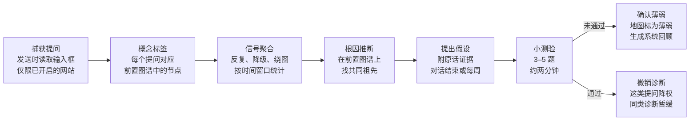

# Chat2Know 模块：学习诊断

2026-10-28 · Shaowen Fu

## 模块目标与定位

**目标：从用户在 AI 网站上的提问中，推断出真正的知识薄弱点，并在知识地图上标注出来。**

用户常常带着模糊的疑问去问 AI，却一直问不到点子上；AI 每次只针对当次问题给出片面回答，用户可能在一个点上绕很久，最终也没抓住关键。比如在求解题目时反复问转置的运算规则、反复问怎么求导，说明真正的卡点不在题目本身，而在基础上。这时需要的是系统性回顾，而不是继续一个一个零散地问。

期望的效果是插件主动告诉用户：

> 根据你最近的提问，你对矩阵运算的基本性质可能不太熟悉，已经在知识地图上标注出来了。

**定位：** 这是 Chat2Know 最有"教师感"的模块。好老师不只回答你问的问题，还会从你问问题的方式里看出你哪里没打好基础。它和主方案的关系如下：

- **数据来源不同。** 主方案的捕获来自用户主动划词和点按钮；本模块来自用户自己发出的提问，需要单独开启。
- **服务同一个北极星。** 确认的薄弱点会被建议设为"内化"，进入考我和间隔重复，直接贡献"通过检验的内化类卡片数"。
- **领域基础。** 这个方向在教育技术里称为知识追踪（knowledge tracing），即根据学习历史推断对每个知识点的掌握程度。本模块的不同之处是用"提问历史"代替"作答历史"。

主方案见 [Chat2Know：浏览器插件项目方案](https://claude.ai/artifact/LNYrkSaddLaUjfMwA8XSHx)。

## 三类信号

提问会暴露三类信号。前两类比较好识别，第三类最有价值，也最难。

| 信号 | 含义 | 判断方法 | 例子 |
| --- | --- | --- | --- |
| 反复 | 同一概念在不同对话里被问了多次，说明没有内化，每次用到都要重新查 | 按概念标签统计一段时间内的提问次数和跨对话数 | 在不同题目里多次问转置的运算规则 |
| 降级 | 在做较高层次的任务，问的却是它的前置知识；问题层级和任务层级不匹配 | 比较提问概念与当前对话主题在前置图谱中的层级差 | 求解优化问题时，问矩阵乘法的基本性质 |
| 绕圈 | 同一段对话里换着说法问相似的问题，一直没有收敛 | 连续提问的语义相似度持续偏高，且没有出现推进信号 | 在矩阵求导上先问为什么要转置，再问为什么维度对不上，又问为什么两本书公式不同 |

三类信号可以叠加：同一个根源概念同时引发反复和绕圈，诊断的置信度就更高。

## 诊断流程

单个提问只是症状，诊断在知识图谱上完成。从提问推断一定有噪声，所以流程的终点不是结论，而是一个经过确认的假设。



*诊断先是假设，经小测验确认后才标注。*

捕获和打标签是持续进行的；信号聚合和根因推断按时间窗口批量运行；只有小测验未通过，地图上才会出现"确认薄弱"。

**控制成本的做法：**

- 概念标签不在每次提问时实时调用模型，而是积累一批后统一打标签。
- 绕圈检测用嵌入向量计算语义相似度：调用用户配置的嵌入模型，向量缓存在本地，每条提问只嵌入一次。
- 只有达到阈值的候选，才交给模型做根因推断和生成小测验。

## 识别绕圈与根因推断

### 识别绕圈

绕圈的特征：同一段对话里，连续几次提问在语义上聚成一团，却没有出现"懂了""那下一步呢"这类推进信号。

1. 用嵌入向量（云端嵌入模型计算，向量存本地）计算同一对话内相邻提问的语义相似度。
2. 相似度持续高于阈值、且跨越若干轮的一组提问，标为一个绕圈候选。
3. 把这一组提问一起交给模型，问它：**有没有一个更底层的概念，能同时解释所有这些困惑？**

大模型逐个回答时看不到这个规律，把问题放在一起看才看得到。典型例子是矩阵求导：用户先问"为什么结果要转置"，再问"为什么维度对不上"，又问"为什么两本书的公式不一样"。每个问题单独回答都没错，但真正的关键往往是**布局约定**（分子布局与分母布局）没有弄清楚。抓住这一点，前面的问题一起解决。

### 根因推断

1. **打概念标签。** 例如"转置的运算规则"对应：线性代数 → 矩阵运算 → 转置性质。
2. **在前置关系图上找共同祖先。** 如果转置性质、矩阵乘法顺序、迹的性质都被反复问到，它们共同的前置节点"矩阵运算基本性质"就是候选根源。
3. **选能解释最多症状的最底层节点**作为诊断结论。绕圈识别出的关键概念，直接作为一个高权重的候选。

### 前置关系图从哪来

- **冷启动：** 由模型按需生成某个领域的前置结构，例如"线性代数""矩阵微积分"，缓存在本地。
- **持续修正：** 用户自己的知识图谱会逐渐补充和修正它。
- **社区种子图谱：** 开源后，常见领域可以由社区贡献经过校对的前置图谱，作为可选下载。

前置关系图与用户的笔记图谱是两张图：前者描述"知识本身的依赖结构"，后者记录"用户学过什么"。前置图中的概念通过 ID 关联到笔记节点。

## 确认与呈现

从提问推断一定有噪声：用户问一个基础问题，可能只是想核对、在帮别人解题，或者只是懒得自己推。误判时直接下结论会很烦人，所以诊断先是假设，确认后才标注。

### 提出假设：附证据

> 最近两周，你有 7 次提问涉及矩阵转置和乘法的性质。根据这些提问，矩阵运算的基本性质可能值得系统回顾一下。

每条证据都是用户的原话，点开可以跳回当时的对话。

### 小测验确认

- 3–5 题，约两分钟，题目针对诊断出的根源概念，而不是用户问过的具体题目。
- **未通过：** 节点在地图上标为确认薄弱，掌握要求建议设为"内化"。插件生成一份系统回顾：按问题树组织，从最底层的概念讲起，而不是继续零散地回答。
- **通过：** 撤销诊断，这类提问在之后的聚合中降低权重，同类诊断一段时间内暂缓。
- 用户也可以跳过测验，直接接受或否定诊断。

### 地图上的状态

| 状态 | 含义 | 显示 |
| --- | --- | --- |
| 疑似薄弱 | 有信号，尚未确认 | 浅色标记，不打扰 |
| 确认薄弱 | 小测验未通过，或用户主动接受 | 醒目标记，附系统回顾入口 |
| 已补强 | 系统回顾后，考我通过 | 恢复正常，保留历史 |

### 提醒策略

- **不在提问当下弹出。** 那时用户正专注在题目上。
- **在合适时机给出：** 一段对话结束时，或每周一份"学习诊断"。
- **阈值和频率上限：** 证据不够不报；被忽略过的诊断，短期内不再提。
- **措辞客观：** 说"可能值得系统回顾"，不说"你基础不扎实"。
- **每个诊断都有"准"和"不准"两个按钮：** 既是用户的控制权，也是改进诊断准确率的数据。

## 提问捕获与隐私约束

### 捕获方案：站点配置 + 通用规则

内容脚本常驻在用户开启的网站上，在发送那一刻读取输入框里的文本（在网站清空输入框之前）。分三层：

1. **站点配置**：ChatGPT、Claude、Gemini、DeepSeek、Kimi 等主流网站各有一小段配置，写明输入框、发送按钮和"用户消息"的位置，按配置精确捕获。
2. **通用规则**：没有配置的网站，监听可编辑区域（`textarea` 或 `contenteditable`）里的回车（排除 Shift+回车和输入法选词中的回车），以及输入框附近的发送按钮。
3. **去重与健康检查**：同一条提问几秒内只记一次；页面上出现了新的用户消息却没有捕获到时，在侧栏提示该网站的配置可能已失效。

每个站点配置都有对应的页面快照，自动测试用它验证配置仍然有效。

- 只记录用户自己发出的提问。可选附带 AI 回答的前几句作为上下文，帮助判断提问的语境。
- 对话标识用页面 URL，用来判断"同一段对话"和"跨对话"。
- 密码框、支付表单等敏感输入永不捕获，只在用户开启的网站上运行。

### 权限变化

主方案的设计是按需注入脚本、最小权限。持续记录提问需要在这些网站上常驻运行，必须申请对应网站的访问权限。因此这个模块使用**可选主机权限**：用户开启时才申请，只申请用户勾选的网站。

### 隐私约束（不可妥协）

1. **主动开启。** 默认关闭。用户自己勾选要启用诊断的 AI 网站。
2. **状态可见。** 启用后，插件图标上有明显标识；可以一键暂停，也可以排除某段对话。
3. **只存本地。** 提问记录存在 IndexedDB，可以查看、搜索、逐条删除或全部清空。
4. **说清楚数据去向。** 打标签、根因推断和生成测验时，提问会发送给用户配置的模型服务商。开启时要明确告知这一点。
5. **不进导出默认项。** 导出知识图谱时，提问记录默认不包含，需要单独勾选。
6. **如实披露。** 上架 Chrome 和 Firefox 商店时，隐私说明里如实写明这项数据收集。

## 数据模型

本模块新增以下表，与主方案的 `nodes`、`edges`、`reviews` 等表共存于同一个 IndexedDB。

| 表 | 关键字段 | 用途 |
| --- | --- | --- |
| `asks` | `id`、`site`、`conversationUrl`、`text`、`contextSnippet`、`sentAt`、`excluded` | 用户发出的每一条提问 |
| `askTags` | `askId`、`conceptId`、`confidence`、`taggedAt` | 提问与概念的对应，一条提问可以对应多个概念 |
| `concepts` | `id`、`domain`、`name`、`level`、`nodeId`、`source`（generated / community / user） | 前置关系图中的概念；`nodeId` 关联到笔记图谱中的节点 |
| `prereqEdges` | `from`、`to`、`source` | 概念之间的前置关系：学 `to` 之前需要先掌握 `from` |
| `diagnoses` | `id`、`rootConceptId`、`signals`、`evidenceAskIds`、`status`、`quizId`、`feedback`、`createdAt` | 诊断记录；`status` 为 suspected / confirmed / dismissed / remediated |
| `quizzes` | `id`、`diagnosisId`、`items`、`answers`、`score`、`takenAt` | 确认用的小测验 |

```ts
type SignalKind = 'repeat' | 'downshift' | 'circling';
type DiagnosisStatus = 'suspected' | 'confirmed' | 'dismissed' | 'remediated';

interface Diagnosis {
  id: string;
  rootConceptId: string;        // 诊断出的根源概念
  signals: { kind: SignalKind; count: number }[];
  evidenceAskIds: string[];     // 作为证据的原话，可跳回原对话
  status: DiagnosisStatus;
  quizId?: string;
  feedback?: 'accurate' | 'inaccurate';
  createdAt: number;
}
```

- `asks` 和 `diagnoses` 不进入导出默认项，也不写主方案的 `oplog`。将来如果做同步，需要用户单独授权。
- 删除一条提问时，同步删除对应的 `askTags`，并从相关诊断的证据中移除。

## 里程碑与验收标准

**进度（2026-10-30）：** D1–D4 已完成，执行记录与偏差说明见 `tasks/LONG-RUN-D1-D4.md`。与本文的主要差异：

- 健康检查（出现新的用户消息却没捕获到时提示）和"附带 AI 回答的前几句"暂未做。
- 确认发送的依据是：回车或点击后 2 秒内输入框被清空，这样能排除没真正发出去的情况。
- `askTags.confidence`、概念的 `level` 和 `source` 不存储：层级由前置图谱推出。
- "准 / 不准"同时就是"接受 / 否定"。`remediated`（已补强）不存储，由"确认后，概念卡片下要熟记的卡片都通过了检验"推出。
- 被否定的诊断，它用过的提问证据不再参与之后的聚合；同一根源（以及只解释同样症状的更上层概念）30 天内不再诊断。
- 合成序列基线（`tests/unit/rootcause.test.ts`，6 组）：已知根因排第一的比例为 1.0。打标签准确率的评测数据见 `tests/eval/data/tags.json`，需要用真实模型跑 `npm run eval`。

诊断依赖概念标签、知识图谱和小测验，整体放在主方案的教师模式（M5）之后。但**提问记录应该尽早上线**：数据需要时间积累，等诊断做出来时，已经有几个月的真实提问可以用来验证效果。

| 里程碑 | 时间点 | 交付内容 | 验收标准 |
| --- | --- | --- | --- |
| D1 提问记录 | 主方案 M4 之后，尽早 | 开关与网站勾选；可选主机权限；发送时捕获；本地查看、搜索、删除；暂停与排除对话 | 在每个站点配置的页面快照上都能捕获（回车与发送按钮两种方式）；没有配置的网站由通用规则捕获；未开启的网站零捕获；密码框永不捕获；暂停后零捕获 |
| D2 概念标签与前置图谱 | 主方案 M4 之后 | 批量打标签；按领域生成前置图谱并缓存；概念关联到笔记节点 | 在人工标注的提问样本上记录标签准确率作为基线；同一领域的前置图谱只生成一次 |
| D3 信号与根因 | D2 之后 | 反复、降级、绕圈检测；根因推断 | 在构造的合成提问序列（根因已知）上，根因出现在前三个候选中的比例作为基线；绕圈检测只用嵌入相似度，不调用对话模型 |
| D4 确认与呈现 | 主方案 M5 之后 | 假设与证据；小测验；地图状态；提醒策略；准与不准反馈；系统回顾 | 每条证据都能跳回原对话；频率上限生效；测验通过后诊断撤销且同类暂缓；确认薄弱的节点被建议设为"内化" |

## 评测、风险与待定问题

### 如何评测

- **合成序列：** 人工构造若干组提问序列，每组的根因已知，例如"一组提问都源于布局约定不清"。用来测根因推断，可以放进 Claude Code 的自动化测试。
- **自用验证：** 用自己几个月的真实提问跑一遍诊断，逐条判断准不准。
- **线上指标：** 诊断的"准"按钮占比，以及确认薄弱的节点在系统回顾后的考我通过率。

### 风险

| 风险 | 影响 | 应对 |
| --- | --- | --- |
| 误判 | 用户觉得被冒犯，或被打扰 | 先假设后确认；措辞客观；阈值和频率上限；准与不准反馈 |
| 隐私顾虑 | 用户不敢开启 | 默认关闭、只存本地、可随时删除、开启时说清数据去向 |
| 前置图谱质量差 | 根因找错 | 社区种子图谱；用户可修正；把绕圈识别出的关键概念作为高权重候选 |
| API 成本 | 持续调用模型花费高 | 批量打标签；相似度用嵌入（便宜，且每条只算一次、向量存本地）；只对达到阈值的候选调用对话模型 |
| 商店审核 | 常驻权限被质疑 | 可选主机权限、仅限用户勾选的网站、隐私说明如实披露 |

### 待定问题

- [ ] 是否捕获 AI 回答的前几句作为上下文，捕获多少
- [ ] 信号聚合的时间窗口与阈值
- [ ] 前置图谱的概念粒度：到"矩阵运算"还是到"转置性质"
- [ ] 第一个种子图谱选哪个领域
