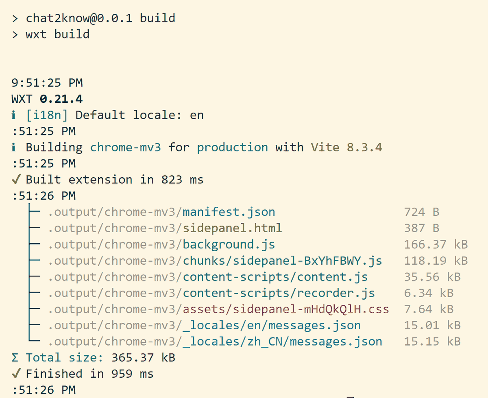
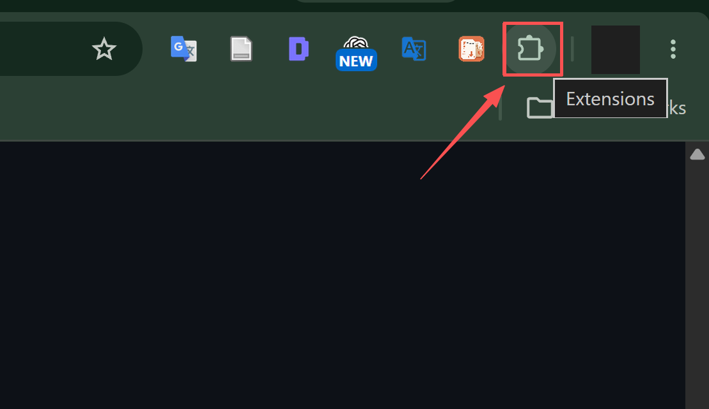
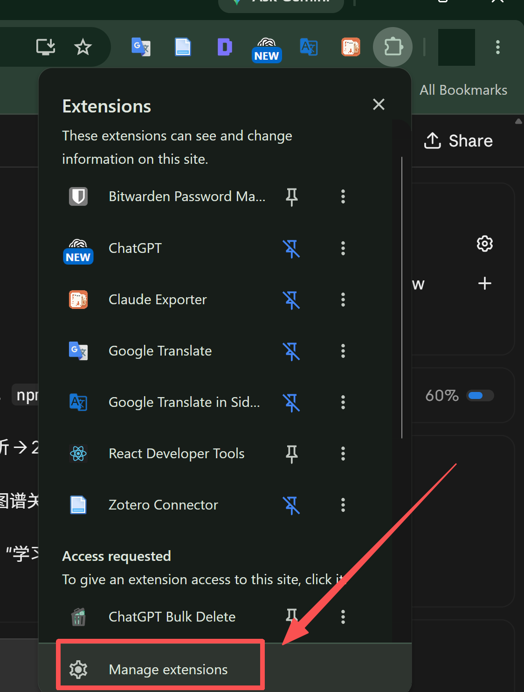
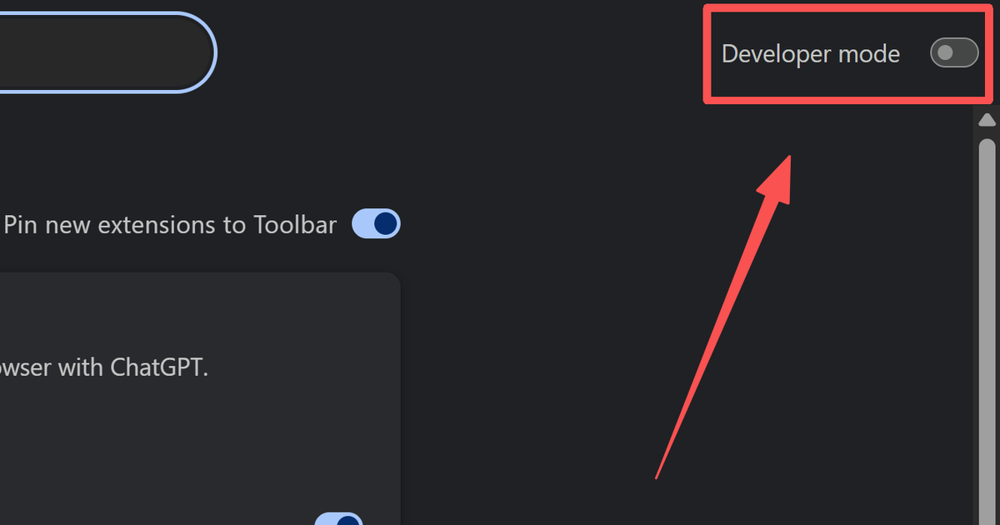
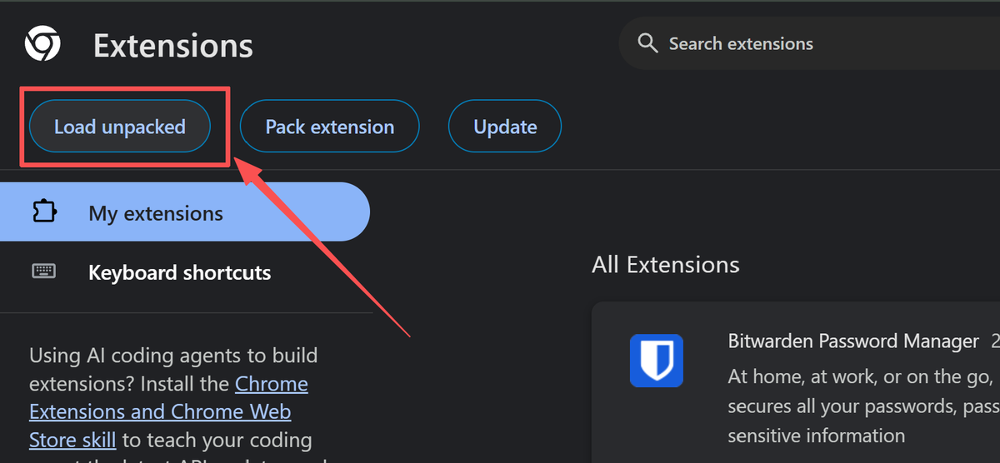
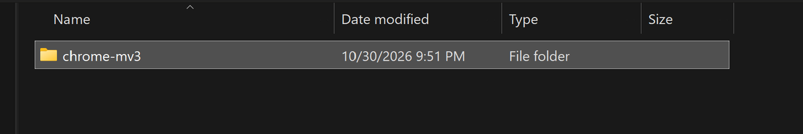
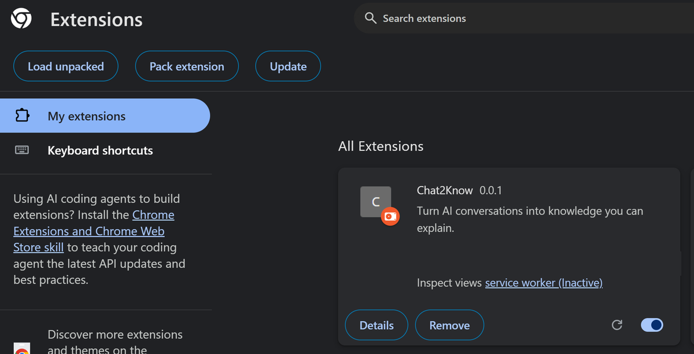
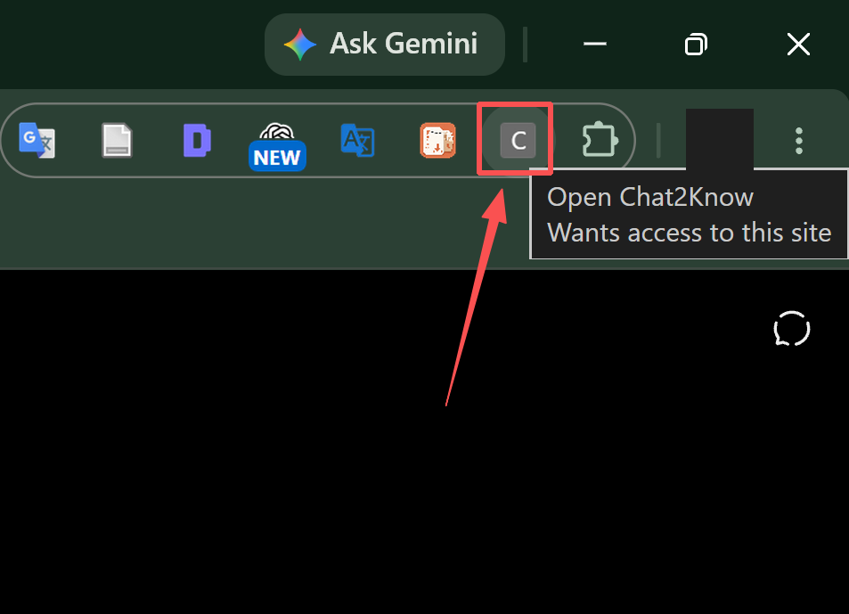

# 安装 Chat2Know · Install Chat2Know

在 Chrome（或 Edge、Brave 等 Chromium 内核浏览器）里以"开发者模式"加载 Chat2Know，大约 5 分钟。暂不支持 Firefox。
Load Chat2Know into Chrome (or Edge, Brave or another Chromium browser) in developer mode. About 5 minutes. Firefox is not supported yet.

## 1. 获取插件 · Get the extension

### A. 下载发布包（推荐）· Download a release (recommended)

不需要安装任何开发工具。打开 [最新发布 / Latest release](https://github.com/shaowenfu/Chat2Know/releases/latest)，下载 `chat2know-<版本>-chrome.zip`，解压到一个固定的文件夹（之后不要删除或移动它）。
No developer tools needed. Open the [latest release](https://github.com/shaowenfu/Chat2Know/releases/latest), download `chat2know-<version>-chrome.zip` and unzip it into a folder you keep (don't delete or move it later).

### B. 从源码构建 · Build from source

需要 [Node.js](https://nodejs.org/) 22 或更高版本，以及 Git。
You need [Node.js](https://nodejs.org/) 22 or later and Git.

```bash
git clone https://github.com/shaowenfu/Chat2Know.git
cd Chat2Know
npm install
npm run build
```

看到 `Finished` 就说明构建好了，插件在项目里的 `.output/chrome-mv3` 文件夹。
When you see `Finished`, the extension is in the project's `.output/chrome-mv3` folder.



## 2. 打开扩展管理页 · Open the extensions page

点浏览器右上角的拼图图标（扩展程序）。
Click the puzzle icon (Extensions) at the top right of the browser.



在弹出的列表底部点 **管理扩展程序 / Manage extensions**。也可以直接在地址栏输入 `chrome://extensions`。
At the bottom of the list, click **Manage extensions**, or type `chrome://extensions` in the address bar.



## 3. 打开开发者模式 · Turn on developer mode

打开页面右上角的 **开发者模式 / Developer mode** 开关。
Turn on the **Developer mode** switch at the top right of the page.



## 4. 加载插件 · Load the extension

点左上角新出现的 **加载已解压的扩展程序 / Load unpacked**。
Click **Load unpacked**, which now appears at the top left.



在弹出的窗口里选中插件所在的文件夹（选文件夹本身，不要进入它），确认：用发布包时是你解压出来的文件夹；从源码构建时是项目里的 `.output/chrome-mv3`。
In the dialog, select the extension's folder itself (do not open it) and confirm: the folder you unzipped the release into, or `.output/chrome-mv3` when you built from source.



列表里出现 Chat2Know 卡片，开关是打开的，就装好了。
Chat2Know now shows up in the list with its switch on.



## 5. 打开侧栏 · Open the side panel

点工具栏上的 Chat2Know 图标打开侧栏。如果看不到图标，先点拼图图标，再点 Chat2Know 旁边的图钉把它固定到工具栏。
Click the Chat2Know icon in the toolbar to open the side panel. If it is not there, open the puzzle menu and pin Chat2Know.



Chat2Know 不申请"读取所有网站"的权限：只有在你勾选的 AI 网站上，选中文字时才会出现小浮层；勾选时浏览器会单独请求该网站的权限。
Chat2Know does not ask to read every site: the bar over a selection shows only on the AI sites you tick, and the browser asks for each one when you tick it.

## 6. 第一次使用 · First use

侧栏第一次打开时是一个三步的首屏，右上角可以切换 中文 / EN。
The first time, the side panel shows three steps; switch 中文 / EN at the top.

1. **连接模型 · Connect your model**：填写任意兼容 OpenAI 格式的接口地址、模型名和 API Key（嵌入模型可选，在"高级"里），点"保存并测试连接"。浏览器会请求访问这个接口地址，只用于调用你的模型。不填也能记，只是记下的内容会先放在"待归位"里。
   Enter any OpenAI-compatible base URL, model and API key (an embedding model is optional, under *Advanced*) and click *Save and test the connection*. The browser asks for access to that one address, used only to call your model. Recording works without a model; notes then wait in *Unplaced*.
2. **勾选网站 · Tick your sites**：勾选你常用的 AI 网站（ChatGPT、Claude、Gemini、DeepSeek、Kimi、豆包）。"也记录我在这些网站上发出的提问"默认开启，用来发现你卡住的地方，可以在这里或设置里关掉。
   Tick the AI sites you use. *Also record the questions I send on these sites* is on by default, to notice when you are stuck; turn it off here or in settings.
3. **新建导图 · Create a map**：一门课或一个主题一张，名字可以不填（插件会按第一批内容起一次名）。建好即打开，之后记下的内容都进这张导图。
   One per subject or topic; the name is optional (Chat2Know names an unnamed map once from its first notes). It opens at once, and what you record goes into it.

然后在勾选的网站上，选中回答里的一段文字，上方会出现 **记下 / 保护原文 / 提问**；公式旁也有 **＋**。其他网页上选中文字按 **Alt+S**，或右键"记到 Chat2Know 导图"。
Then, on a ticked site, select part of an answer and the bar shows **Note / Keep words / Ask**; display formulas also get a **＋**. On other pages, select text and press **Alt+S**, or right-click → *Add to Chat2Know map*.

用过 0.1？见 [从 0.1 升级](migration-v0.1.md)。更多用法见 [README](../README.md#using-it)。
Used 0.1? See [Moving from 0.1](migration-v0.1.md). More in the [README](../README.md#using-it).

## 更新 · Updating

- 发布包：下载新版本的 zip，解压后覆盖原来那个文件夹里的文件。
  Release: download the new zip and unzip it over the files in the same folder.
- 源码：`git pull && npm install && npm run build`。
  Source: `git pull && npm install && npm run build`.

然后在扩展管理页的 Chat2Know 卡片上点刷新按钮 ⟳。数据保存在浏览器里，更新不会丢失。
Then click the reload button ⟳ on the Chat2Know card in the extensions page. Your data stays in the browser across updates.

## 常见问题 · Troubleshooting

- **`npm install` 很慢或失败 / is slow or fails**：检查 Node.js 版本（`node -v` 应为 22 或以上）；国内网络可以设置镜像 `npm config set registry https://registry.npmmirror.com`。
  Check `node -v` (22 or later).
- **加载时报错"清单文件缺失" / "Manifest file is missing"**：选的文件夹不对，应选直接包含 `manifest.json` 的那个文件夹：解压出来的文件夹，或 `.output/chrome-mv3`（不是项目根目录，也不是 `.output`）。
  You picked the wrong folder: choose the one that directly contains `manifest.json`, the unzipped folder or `.output/chrome-mv3` (not the project root or `.output`).
- **选中文字后没有小浮层、公式旁没有 ＋ / No bar over a selection, no ＋ beside formulas**：先在侧栏勾选这个网站；勾选前已经打开的页面会自动加上，个别页面需要刷新。在输入框里选中的文字不会出现浮层，只选了一两个字也不会。只有独立成行的公式旁才有 ＋，行内公式请选中后点"记下"。浏览器自带页面（`chrome://`、扩展商店）上插件不能运行。
  Tick the site in the side panel first; pages already open get it at once, a few need a reload. No bar appears for text selected in an input box, or for one or two characters. Only formulas on a line of their own get a ＋; for inline ones, select them and click *Note*. Extensions cannot run on built-in pages such as `chrome://` or the Web Store.
- **记下时提示"还没有打开的导图" / "No map is open"**：在侧栏顶部打开或新建一张导图，或直接点提示里的"新建导图并记下"。
  Open or create a map at the top of the side panel, or click *create a map and add this* in the toast.
- **浮窗提问报错 / The Ask window shows an error**：错误原样来自你的模型服务商，例如 `HTTP 401` 表示 Key 不对，`HTTP 402` 表示余额不足。在设置里检查模型配置并点"测试连接"。
  The error comes from your model provider as it wrote it: `HTTP 401` means the key is wrong, `HTTP 402` that the balance is used up. Check the model in settings and click *Test connection*.
- **Alt+S 没反应 / Alt+S does nothing**：在 `chrome://extensions/shortcuts` 查看是否被其他扩展占用，可以改成别的组合键。
  Check `chrome://extensions/shortcuts`: another extension may use it; pick another key there.
