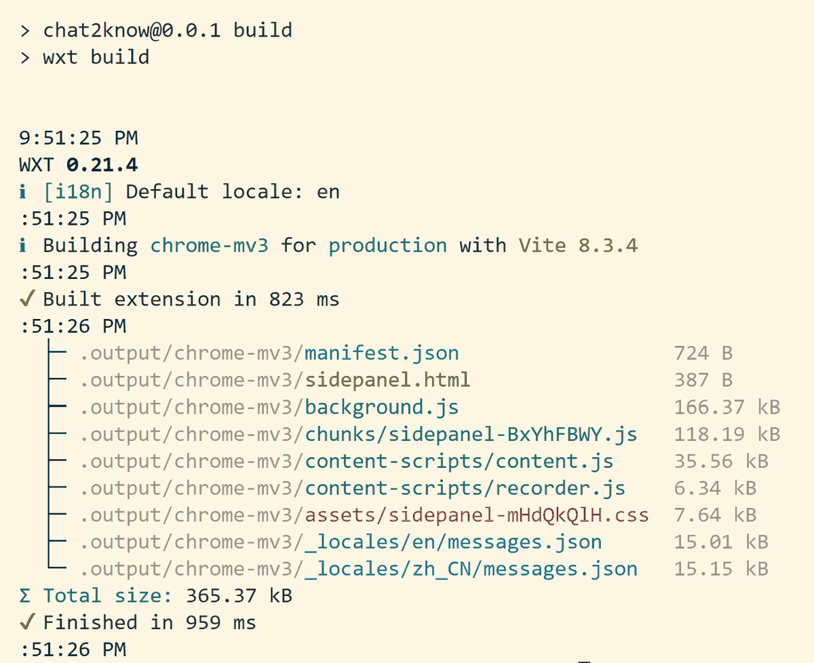
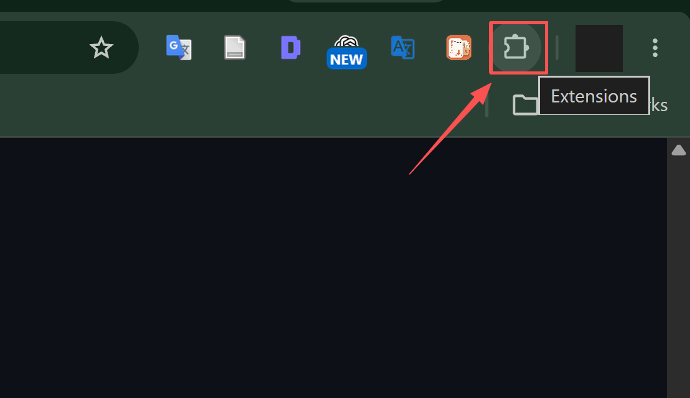
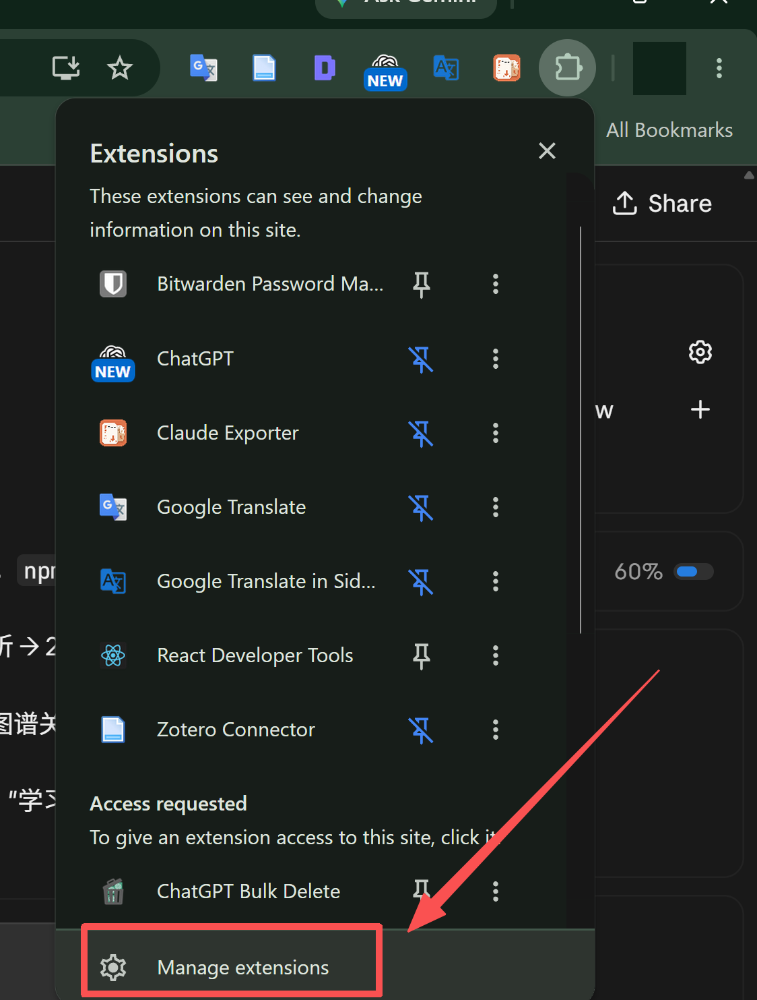
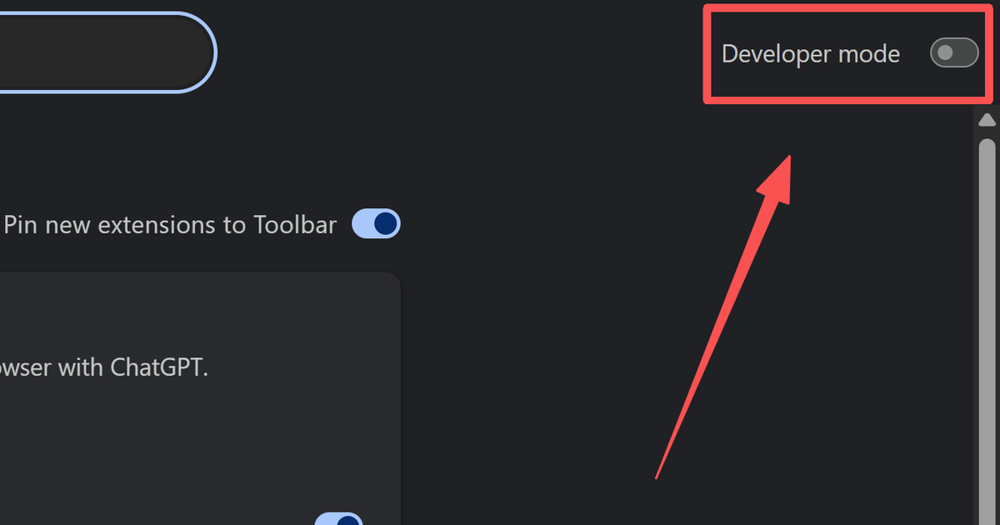
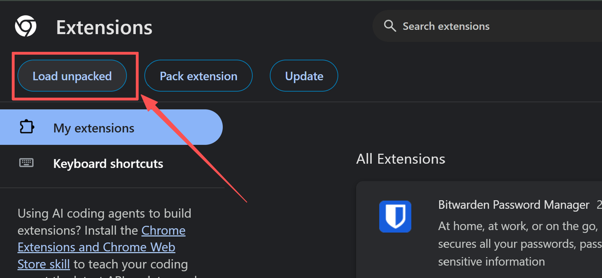
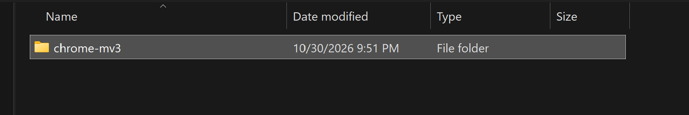
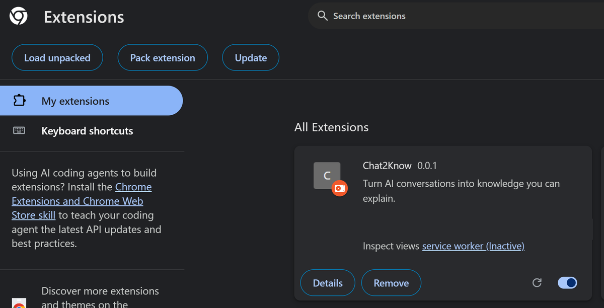
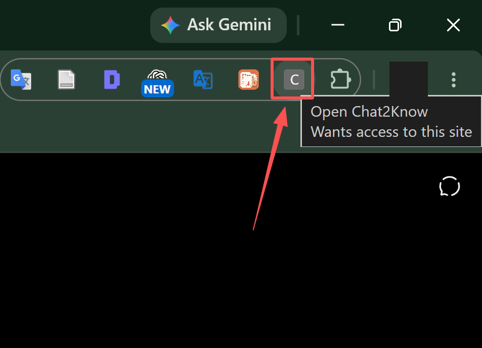

# 安装 Chat2Know · Install Chat2Know

在 Chrome（或 Edge 等 Chromium 内核浏览器）里以"开发者模式"加载 Chat2Know，大约 5 分钟。
Load Chat2Know into Chrome (or Edge or another Chromium browser) in developer mode. About 5 minutes.

## 0. 准备 · Before you start

需要 [Node.js](https://nodejs.org/) 22 或更高版本，以及 Git。
You need [Node.js](https://nodejs.org/) 22 or later and Git.

## 1. 下载并构建 · Download and build

```bash
git clone https://github.com/shaowenfu/Chat2Know.git
cd Chat2Know
npm install
npm run build
```

看到 `Finished` 就说明构建好了，插件在项目里的 `.output/chrome-mv3` 文件夹。
When you see `Finished`, the extension is in the project's `.output/chrome-mv3` folder.



## 2. 打开扩展管理页 · Open the extensions page

点浏览器右上角的拼图图标（扩展程序）。
Click the puzzle icon (Extensions) at the top right of the browser.



在弹出的列表底部点 **管理扩展程序 / Manage extensions**。也可以直接在地址栏输入 `chrome://extensions`。
At the bottom of the list, click **Manage extensions**, or type `chrome://extensions` in the address bar.



## 3. 打开开发者模式 · Turn on developer mode

打开页面右上角的 **开发者模式 / Developer mode** 开关。
Turn on the **Developer mode** switch at the top right of the page.



## 4. 加载插件 · Load the extension

点左上角新出现的 **加载已解压的扩展程序 / Load unpacked**。
Click **Load unpacked**, which now appears at the top left.



在弹出的窗口里进入项目的 `.output` 文件夹，选中 `chrome-mv3` 文件夹（选文件夹本身，不要进入它），确认。
In the dialog, go into the project's `.output` folder, select the `chrome-mv3` folder itself (do not open it), and confirm.



列表里出现 Chat2Know 卡片，开关是打开的，就装好了。
Chat2Know now shows up in the list with its switch on.



## 5. 打开侧栏 · Open the side panel

点工具栏上的 Chat2Know 图标打开侧栏。如果看不到图标，先点拼图图标，再点 Chat2Know 旁边的图钉把它固定到工具栏。
Click the Chat2Know icon in the toolbar to open the side panel. If it is not there, open the puzzle menu and pin Chat2Know.



提示里的"想要访问此网站 / Wants access to this site"是正常的：Chat2Know 不申请"读取所有网站"的权限，只有你在某个页面上点了它的图标（或按快捷键、用右键菜单）时，才能在这个页面上划词保存。
"Wants access to this site" is expected: Chat2Know does not ask to read every site. It works on a page once you click its icon there (or use a shortcut or the right-click menu).

## 6. 第一次使用 · First use

1. 在侧栏点 **⚙** 填写模型设置：任意兼容 OpenAI 格式的接口地址、模型名和 API Key。不填也能保存知识，只是不能提炼和回答。
   In the side panel, click **⚙** and enter any OpenAI-compatible base URL, model and API key. Saving works without a model; distilling and answering need one.
2. 在任意网页上划选一段文字，点浮动工具条上的 **存知识 / Save**，卡片就出现在侧栏里。
   Select text on any page and click **Save** in the floating toolbar; the card appears in the side panel.

更多用法见 [README](../README.md#using-it)。
More in the [README](../README.md#using-it).

## 更新 · Updating

```bash
git pull
npm install
npm run build
```

然后在扩展管理页的 Chat2Know 卡片上点刷新按钮 ⟳。数据保存在浏览器里，更新不会丢失。
Then click the reload button ⟳ on the Chat2Know card in the extensions page. Your data stays in the browser across updates.

## 常见问题 · Troubleshooting

- **`npm install` 很慢或失败 / is slow or fails**：检查 Node.js 版本（`node -v` 应为 22 或以上）；国内网络可以设置镜像 `npm config set registry https://registry.npmmirror.com`。
  Check `node -v` (22 or later).
- **加载时报错"清单文件缺失" / "Manifest file is missing"**：选的文件夹不对，应选 `.output/chrome-mv3`，不是项目根目录，也不是 `.output`。
  You picked the wrong folder: choose `.output/chrome-mv3`, not the project root or `.output`.
- **划词后没有工具条 / No toolbar after selecting text**：先在这个页面上点一次 Chat2Know 图标，或用快捷键 **Alt+Shift+K**、右键菜单保存。浏览器自带页面（`chrome://`、扩展商店）上插件不能运行。
  Click the Chat2Know icon on that page once, or use **Alt+Shift+K** or the right-click menu. Extensions cannot run on built-in pages such as `chrome://` or the Web Store.
