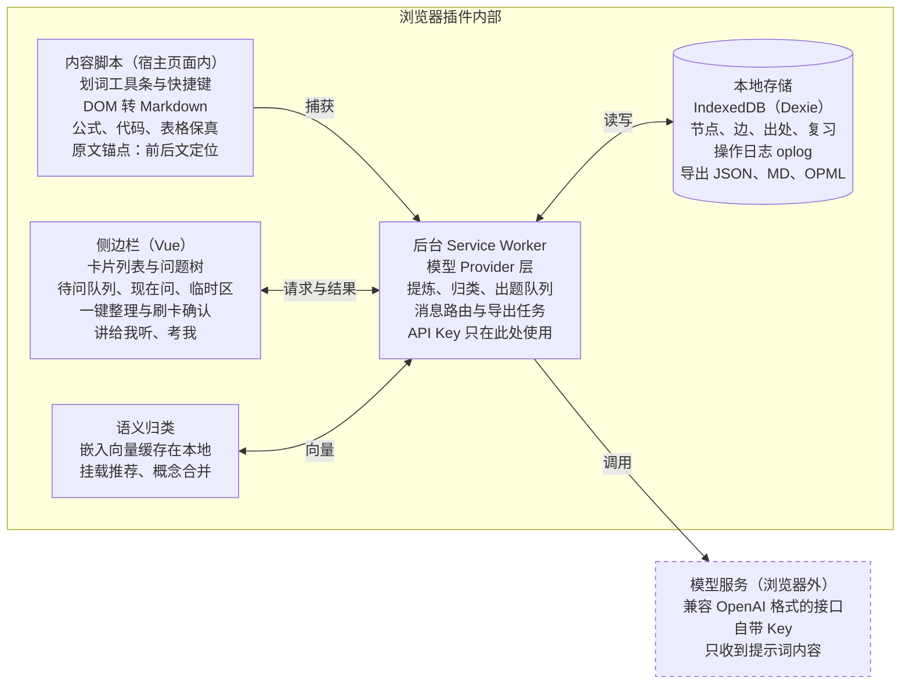

# Chat2Know：浏览器插件项目方案

2026-10-27 · Shaowen Fu

## 北极星目标

**让每一次与 AI 的对话，都沉淀成你离开对话后仍能讲得出来的知识。**

这个项目不是更好的聊天界面，而是叠在所有 AI 客户端之上的"知识层"：负责捕获、蒸馏、组织和检验。

**北极星指标：每周通过检验的"内化"类卡片数。** 只统计被标为"内化"、并在"考我"或"讲给我听"中通过的卡片。保存不算，"理解"和"索引"两类也不算：真正决定后续学习能否顺畅进行的，是那些必须不查就能调出来的知识。保存只是收藏，能讲出来才算掌握。

**个人验收测试（论文测试）：** 读完一篇论文，24 小时后只看图谱，在 3 分钟内讲清它的问题、方法、结果和局限。每个里程碑都拿真实论文跑一遍这个测试。

| 护栏指标 | 目标 | 为什么重要 |
| --- | --- | --- |
| 捕获操作数 | 选中后 1 次点击或 1 个快捷键 | 打断阅读就没人用 |
| 原文入库耗时 | 小于 1 秒，AI 提炼异步进行 | 捕获不能等模型 |
| 精华压缩比 | 卡片约为原文的 10–20% | 精华才值得复习 |
| 宿主对话污染 | 0：现在问、稍后问都不写入原对话 | 主线上下文保持干净 |
| 出处回溯成功率 | 95% 以上能跳回原文位置 | 只看精华也能放心 |
| 数据可带走 | 任何时候 100% 可导出 | 用户信任的底线 |

开源本地版不做任何遥测。这些指标显示在本地统计面板里，只给用户自己看。

## 问题与核心洞察

直接在网页里问 AI，会同时遇到三个问题。前两个是工具问题，第三个是学习问题，也是本项目的真正切入点。

1. **对话是线性的，知识是树状的。** 每个回答里都可能有知识盲区。在线性对话里追问，主线被冲走，上下文越来越长，AI 开始偏离重点。
2. **信息没有被蒸馏。** 回答里大部分内容与语气、铺垫、上下文衔接有关，真正值得记住的只占一小部分。精简全靠手动整理，所以基本不会发生。重要的见解、灵感、启发都散落在对话里。
3. **读懂的错觉。** 读 AI 的流畅解释时感觉全懂了，离开对话却说不清楚，脑子里没有基本语料。原因不是没记笔记，而是从来没被要求自己说出来。回头重读整段对话，效率又太低。

**核心洞察：** 只解决前两个，得到的是一个更好的笔记工具。把"检验与复述"也做进来，才是"教师"。竞品大多停在整理层，检验层是差异化所在。

## 产品原则

出现取舍时，按下面的顺序判断。

1. **不做对话界面，做知识层。** 以浏览器插件形态存在，在任何 AI 客户端上都能用。
2. **捕获即时，整理延后，确认批量。** 阅读时只需一个动作；归类和提炼由 AI 提议，用户事后一次确认。
3. **不打断阅读。** 遇到不懂的地方默认"稍后问"；捕获时不调用 AI、不弹出答案。
4. **提问不等于记录。** 提问是为了弄懂，记录是为了以后再用。问答默认进入临时区，只有值得再用的部分才进入图谱。
5. **问句是入口，陈述是内容。** 节点标题用问句组织探索过程，精华卡片用陈述句保存结论。
6. **不做站点适配。** 只抓文本，结构交给模型还原。网站改版不应该让核心功能失效。
7. **本地优先，数据属于用户。** 免登录，自带 API Key，数据存在本地，任何时候都能完整导出。
8. **精华与原文双层。** 精华卡片用来读和复习，原文用来回溯和印证。
9. **检验高于收藏。** 衡量价值的是能讲出来多少，而不是存了多少；检验强度跟随掌握要求。
10. **AI 提议，人决定。** 图谱结构、记不记、掌握要求，都由 AI 给默认值，用户一键确认或修改。

## 核心功能与交互设计

交互的重点只有一个：把对话里的内容丝滑地沉淀进跨会话的知识图谱。整个产品围绕一条流程展开：

**问 → 记不记 → 掌握要求 → 检验**

1. **问**：现在问，或稍后问。答案先进入临时区。
2. **记不记**：只有以后会再用的部分才进入图谱，并且记的是可迁移的结构，而不是照搬答案。
3. **掌握要求**：记下的知识分为内化、理解、索引三类。
4. **检验**：按掌握要求走不同的检验方式。

### 1. 划词捕获（通用基础层）

在任意网页选中文字，旁边浮出小工具条，也可以用快捷键：

- **存知识**：原文立即入库；AI 异步提炼成精华卡片，并推荐挂到图谱的哪个节点下。
- **存灵感**：原样保存，标为灵感类型，不压缩。
- **问**：分为"稍后问"和"现在问"，默认稍后问。见第 2、3 条。

这一层不依赖网站结构，所以在 AI 对话页、普通网页、在线 PDF、论文页面上都能用。

### 2. 稍后问（不打断阅读）

场景：正在读一个回答，中间出现一个知道、但没彻底弄懂的名词。它不影响当前的整体理解，你想先把这个回答读完。

- 选中名词，点"稍后问"或按快捷键（如 `Alt+Q`）。
- 插件自动把选区扩展到名词所在的整句，名词在句中高亮。按句切分用浏览器自带的 `Intl.Segmenter`，中英文通用，不依赖网站结构。
- 弹出一行输入框写疑问，下方有快捷选项：`是什么？`、`为什么？`、`和……有什么区别？`、`在这里起什么作用？`。回车保存；按 Esc 也会保存，疑问以后再补。
- 此刻不调用 AI、不弹出答案。页面上该名词加一条淡下划线，侧栏的"待问"计数加一。整个过程在两三秒内完成。

存下的是一个**疑问节点**：标题是你的疑问，附带整句引用和出处锚点；父节点是你当时正在读的那个问题；状态为待解决。

读完当前回答后，在侧栏的**待问队列**里集中处理，每个疑问有两种问法：

- **在侧栏里问**：把"引用句 + 父问题 + 你的疑问"一起发给模型，答案针对这个语境，而不是泛泛的百科解释。
- **插回原对话问**：插件把"引用句 + 你的疑问"整理成一段追问并复制到剪贴板，你自己粘贴进宿主网站的输入框。插件不自动填写网页输入框，因此不需要适配任何网站。适合和当前对话强相关的问题；小问题直接在侧栏里问即可，不必回到主对话。

**重复是重要信号。** 同一个名词被稍后问三次以上，插件提示："这个词你已经问过三次了，要不要标为内化？"

### 3. 现在问（不污染主对话）

需要立刻弄懂才能继续读时，用现在问。插件用自己的模型调用，在侧栏里给出简短解释。宿主对话完全不受影响：上下文不变长，主线不跑偏。这就是"分支式提问"，只是分支长在你自己的图谱里。

### 4. 问与记分离：临时区与记录建议

提问可以随意，记录必须克制，否则笔记很快就臃肿到没法复习。

- **临时区**：现在问和稍后问的答案，默认进入侧栏的临时区，7 天后自动清理。只有点了"记下"，才进入知识图谱。"不记"是默认，不需要任何操作。
- **记录建议**：点"记下"时，AI 先判断问题类型，再建议记什么，而不是照搬答案。

| 问题类型 | 例子 | 建议记什么 | 形式 |
| --- | --- | --- | --- |
| 概念 / 机制 | VLM 是什么 | 可迁移的结构、机制、因果关系，例如 VLM 由哪几部分组成、各自起什么作用；而不是字面定义 | 精华卡片 |
| 实例 / 事实 | InternVL3.5 是什么 | 最多一条"是 VLM 的一个例子"；机构、能力等变化快、随时可查的信息不记 | 挂在概念节点下的一条关系 |
| 一次性好奇 | 某个名字的由来 | 不记 | 看完即弃 |

- **问题升级**：卡片标题改写成更值得复习的问题。例如原始提问"VLM 是什么"，卡片标题改为"VLM 由哪几部分组成，各自起什么作用？"。原始提问保留在出处里，作为理解路径。
- **从取舍中学习**：用户每次接受、修改或删除建议都是一条信号。比如总是删掉"公司、发布时间"这类信息，插件就记为偏好，以后不再推荐。偏好以几条示例的形式存在本地，提炼时带给模型参考。

### 5. 以问句组织知识

学习本身是探索和追问的过程。问句适合组织"学"的过程，陈述句适合组织"存"的结果，所以每个节点两者兼有：

- **标题是问句**：你当时真正想知道的问题。问句制造信息缺口，驱动好奇心；它也是天然的提取线索，直接就是"考我"的题面。
- **精华卡片是陈述句**：1–3 句话的答案，压缩后便于复习、引用和讲给别人听。
- **父子关系是"由哪个答案引出了这个问题"**：保留理解路径，路径本身就是记忆线索。
- **未回答的问题保留为开放节点**：它们构成图谱的边界，一眼就能看出"我还不懂什么"。

两点约束：

- 定义、符号约定这类硬写成问句会很别扭的知识，标题可以直接用陈述句。
- 问句最好由用户自己提出。AI 只帮忙改写得更清楚，不替用户批量生成问题：自己问出来的问题，才带着真正的好奇心。
- **没有提问的节点（例如划词"存知识"）**：AI 提议三个候选问句标题，外加一个自定义输入框，由用户选择或自己输入。这一步在批量确认时完成，不打断阅读。

两种视图：**探索视图**按问题链展开，用于学习过程；**结论视图**把答案按主题重排成陈述式提纲，用于复习、导出和生成"一分钟讲清楚"稿。

### 6. 掌握要求：内化、理解、索引

分界线不在"理解还是背诵"，而在：**后续学习时，这条知识需不需要不查就能立刻调出来。**

依据有两点。第一，工作记忆容量很小：反复作为前提出现的知识如果不熟练，每次都要回想或查找，会占满工作记忆，没有余力理解新内容；熟练之后它变成一个"组块"，几乎不占工作记忆。第二，识别远比回忆容易：看着解释觉得懂，只说明到达了识别的强度，不代表能在没有提示时说出来。

| 掌握要求 | 要求 | 例子 | 检验方式 |
| --- | --- | --- | --- |
| 内化 | 不查就能说出来，并且会用 | 领域核心概念、符号含义、关键公式；一篇论文的问题、方法、结果、局限 | 考我、间隔重复、用它解题 |
| 理解 | 能讲清为什么，需要时能重新推出来 | 推导过程、设计选择背后的原因 | 讲给我听，解释"为什么" |
| 索引 | 知道它存在，知道去哪找 | 实验数字、超参数、产品信息 | 能回溯到出处即可 |

- **AI 建议，用户确认。** 依据三个问题：后续有多少知识依赖它（在图谱中被依赖越多，越该内化）；用到它的场景能不能查；查一次和记住它的成本哪个高。
- **内化不等于死记硬背。** 要求的是理解之上的熟练提取，检验方式是讲出来、用出来，而不是逐字默写。不理解就背下的知识，换个场景就用不出来。
- **分类是动态的。** 同一个概念入门时只需理解，进入研究方向后可能需要内化。

### 7. 侧栏实时子树

侧边栏常驻右侧，显示当前对话正在长出来的那棵问题子树。可以把一段回答直接拖到某个节点下。用户随时看得到自己在知识树的什么位置，不容易跑偏。

### 8. 一键整理

两种入口：

- **整页整理**：抽取当前页面主体文本，由模型切分问答轮次并生成候选卡片。
- **粘贴整理**：用宿主网站的"复制"按钮复制回答，粘贴到侧栏。这是抓取失败时的兜底方案，保真度也最高。

候选卡片同样遵循记录建议：按问题类型给出建议，逐张保留、修改或丢弃。几十秒就能过完一整段对话，不用从头重读。

### 9. 图谱回流

提问时，一键把相关卡片作为背景注入宿主网站的输入框，例如"我已经知道 A、B，不清楚 C"。AI 不再重复讲你已经懂的内容，回答更短更准。

### 10. 教师模式

检验方式跟随掌握要求：

- **考我**：针对内化类卡片，以问句标题为题面，按间隔重复安排复习。
- **讲给我听**：针对一棵子树或理解类卡片，用打字或语音复述。AI 指出漏掉和讲错的地方，并在图谱上标红。
- **一分钟讲清楚**：从结论视图为一棵子树生成一份可以直接说出口的复述稿。

### 11. 出处回溯

每张卡片记录来源 URL、原文片段和原始提问，点一下就能跳回原文位置。

### 节点类型

| 类型 | 内容 | 标题形式 | 掌握要求 |
| --- | --- | --- | --- |
| 知识 | 概念、机制、结论、方法 | 问句（定义类可用陈述句） | AI 建议，用户确认 |
| 见解 | 自己的理解和判断 | 问句或陈述句 | 默认理解 |
| 灵感 | 想法、启发、待验证的点子 | 陈述句 | 不检验 |
| 疑问 | 稍后问或尚未解决的问题 | 问句 | 解决后转为知识 |
| 主题 | 用来分组的节点 | 名词 | 不检验 |

## 技术架构

第一阶段的架构是本地优先加自带 Key：所有数据存在浏览器里，唯一离开浏览器的是发给你所配置模型服务的提示词。



*数据只存在本地，只有模型调用离开浏览器。虚线框在浏览器之外；其余部分都运行在插件内部。*

内容脚本只负责捕获，侧栏只负责界面，所有模型调用和数据读写都经过后台，API Key 只在后台使用。

**技术栈：** WXT（跨浏览器插件框架）+ Vue 3 + TypeScript；Dexie（IndexedDB）；Turndown（HTML 转 Markdown）；fractional-indexing（兄弟节点排序）；Vitest + Playwright（测试）。模型和嵌入都通过用户配置的、兼容 OpenAI 格式的接口调用。

### 通用捕获方案（不做站点适配）

- **选区转 Markdown：** 在 Turndown 上加自定义规则。KaTeX/MathJax 公式从页面保留的 `annotation[encoding="application/x-tex"]` 中取回 LaTeX；代码块保留语言；表格转成 Markdown 表格。
- **消息边界：** 从选区向上查找祖先节点，若其父节点下有多个结构相似的兄弟节点，就把它视为"一条消息"。
- **整页整理：** 抽取页面主体文本，交给模型切分问答轮次。不靠选择器判断哪句是用户说的、哪句是 AI 说的。
- **出处锚点：** 存 URL、原文片段及其前后文，沿用 W3C Web Annotation 的 TextQuoteSelector 思路；跳回时用 Text Fragment（`#:~:text=`）定位。
- **兜底：** 粘贴整理，覆盖所有抓取失败的情况。

### 模型层接口

只支持一种配置：兼容 OpenAI 格式的接口（几乎所有云端服务商都提供）。用户填写接口地址、模型名、Key，以及可选的嵌入模型名。不做流式输出：回答都很短。

```ts
interface ModelSettings {
  baseUrl: string;        // 例如 https://api.openai.com/v1
  model: string;
  apiKey: string;         // 只在后台读取
  embeddingModel: string; // 为空则不启用挂载推荐和概念合并
}

class LlmClient {
  chat(messages: ChatMessage[]): Promise<string>;                          // POST {baseUrl}/chat/completions
  json<T>(messages: ChatMessage[], parse: (v: unknown) => T): Promise<T>;  // 要求返回 JSON 并严格校验
  embed(texts: string[]): Promise<number[][]>;                             // POST {baseUrl}/embeddings
}
```

模型返回的格式不对时直接报错给用户，不做猜测或修补。

### 权限

- 必需：`sidePanel`、`storage`、`activeTab`、`scripting`、`contextMenus`。
- 模型服务的地址作为可选主机权限，用户保存模型设置时再申请。
- 不申请"读取所有网站"权限。内容脚本在用户触发时按需注入。
- 这带来一个约束：`activeTab` 只在用户"调用"插件的那个标签页上生效（点工具栏图标打开侧栏、按快捷键、点右键菜单）。所以划词工具条只出现在用户调用过插件的页面上；没有权限的页面，侧栏会提示改用快捷键或右键菜单，这两种方式本身就会授予权限。
- 跳回出处时打开的是新标签页，没有注入权限，因此主要依靠浏览器原生的 Text Fragment（`#:~:text=`）滚动和高亮；能注入时再用我们自己的锚点做更精确的高亮。

## 数据模型

图谱由"节点 + 边"组成：每个节点有一个主父节点，构成导图的问题树；再加上任意数量的关联边，构成跨会话的图谱。临时区的问答不进入图谱，单独存放。数据从第一天起就按可同步的方式设计，以后加同步不需要迁移。

| 表 | 关键字段 | 用途 |
| --- | --- | --- |
| `nodes` | `id`、`type`、`title`（默认是问句）、`originalAsk`、`summary`（陈述式精华）、`body`、`mastery`、`status`、`askCount`、时间戳 | 知识、见解、灵感、疑问和主题节点 |
| `edges` | `id`、`from`、`to`、`kind`、`order` | `child` 父子关系；`arose_from` 由哪个答案引出了这个问题；`instance_of` 是某个概念的例子；`related` 关联 |
| `sources` | `id`、`nodeId`、`url`、`pageTitle`、`quoteExact`（稍后问时为名词所在整句）、`quotePrefix`、`quoteSuffix`、`capturedAt` | 出处与回溯锚点 |
| `inbox` | `id`、`question`、`quote`、`answer`、`parentNodeId`、`createdAt`、`expiresAt`、`promotedNodeId` | 临时区：问答默认存在这里，到期自动清理，点"记下"后转成节点 |
| `reviews` | `id`、`nodeId`、`mode`（recall / explain）、`prompt`、`answer`、`verdict`、`feedback`、`dueAt`、间隔重复状态 | "考我"与"讲给我听"的记录，也是北极星指标的数据来源 |
| `preferences` | `id`、`questionType`、`suggestion`、`userAction`（accept / edit / delete）、`finalText` | 用户对记录建议的取舍，提炼时作为示例带给模型 |
| `embeddings` | `nodeId`、`model`、`dim`、`vector` | 语义归类与概念合并 |
| `oplog` | `id`（混合逻辑时钟）、`entity`、`entityId`、`op`、`patch` | 所有修改的操作日志，为将来的同步预留 |

```ts
type NodeType = 'topic' | 'knowledge' | 'insight' | 'idea' | 'question';
type NodeStatus = 'open' | 'draft' | 'confirmed' | 'mastered';
type Mastery = 'internalize' | 'understand' | 'index';

interface KNode {
  id: string;           // ULID，按时间可排序
  type: NodeType;
  title: string;        // 默认是问句：值得复习的问题（可能经过"问题升级"）
  originalAsk?: string; // 用户当时的原始提问，作为理解路径保留
  summary?: string;     // 陈述式精华，1–3 句
  body?: string;        // 原文 Markdown，保留公式、代码、表格
  mastery?: Mastery;    // AI 建议、用户确认；灵感和主题节点不设
  status: NodeStatus;   // open = 待解决的疑问；mastered 只能由通过的检验设置
  askCount: number;     // 被"稍后问"的次数，重复是重要性信号
  createdAt: number;
  updatedAt: string;    // 混合逻辑时钟，用于将来的冲突合并
  deletedAt?: number;   // 软删除
}
```

- **所有写操作都通过一个仓储层完成**，同时写业务表和 `oplog`。UI 和后台都不直接操作 IndexedDB。
- **兄弟节点排序用分数索引**（fractional index），拖动排序只改一个节点的 `order`。
- **概念合并**：新节点与已有节点的嵌入相似度超过阈值时，提示"是否与某节点合并"，由用户确认；合并时累加 `askCount`。
- **掌握要求的建议**：根据节点被多少 `child` 和 `arose_from` 边依赖、`askCount` 高低给出默认值，用户确认。
- **临时区不写 `oplog`**：它是一次性数据，不参与将来的同步；转成节点时才写入。
- **设置和 API Key** 存在 `chrome.storage.local`，不进入 IndexedDB，导出时默认排除。

## 里程碑与验收标准

每个里程碑都要能独立使用，验收标准写成可以自动测试的形式，交给 Claude Code 按标准实现和自测。M1 不接 AI 也已经是一个有用的工具。

**进度（2026-10-27）：** M0–M4 已完成，执行记录与偏差说明见 `tasks/LONG-RUN-M2-M4.md`。与本表的差异：

- M2 只支持一种模型配置：用户填写兼容 OpenAI 格式的接口地址、模型名和 Key（产品负责人决定，不做 Ollama 和多服务商适配）。
- M4 的嵌入改用同一服务商的 `/embeddings` 接口（可选的嵌入模型），不再在本地运行 transformers.js；没有配置嵌入模型时，挂载推荐和概念合并不显示。
- 稍后问的疑问不记录"父节点"：它是在网页上问的，没有可挂的节点。在侧栏里对回答或卡片"追问"时，才会生成 `arose_from` 子节点。
- 评测脚本已就绪（`npm run eval`），但基线需要产品负责人用真实模型跑一次后提交。
- 真实网站的快照样本尚未到位（见任务卡 T001）。

| 里程碑 | 交付内容 | 验收标准 |
| --- | --- | --- |
| M0 骨架跑通 | WXT + Vue 3 + TypeScript 项目；点击图标打开侧栏；内容脚本、后台、侧栏三方通信；测试与 lint 脚本 | E2E 测试能加载插件并打开侧栏；三方消息往返测试通过；`npm run check` 一条命令跑完全部检查 |
| M1 无 AI 捕获与稍后问 | 划词工具条与快捷键；DOM 转 Markdown；存知识、存灵感；稍后问（整句引用、快捷疑问选项、页面下划线、待问队列）；问句标题的节点；IndexedDB 存储；出处回溯；JSON 与 Markdown 导出，JSON 导入 | 在全部页面快照样本上，公式还原为 LaTeX、代码块保留语言、表格保留结构；稍后问自动截取的整句在中英文样本上都正确；稍后问全程不发出任何网络请求；JSON 导出再导入无损；点击卡片能跳回原文并高亮 |
| M2 接入模型与问记分离 | 设置页：多个 Provider、测试连接；在侧栏回答待问队列；为没有提问的节点提议三个候选问句标题（另有自定义输入）；临时区及到期清理；记录建议（按问题类型）；问题升级；异步提炼与失败重试 | 用本地模拟服务器测完整流程；概念类、实例类、一次性好奇三类问题在固定样本上给出对应形式的建议；临时区到期自动清理且不影响已记下的节点；Key 不出现在日志和导出里；Key 错误或断网时原文照常入库 |
| M3 最小考我、导图与现在问 | 最小"考我"：用户手动把卡片标为"要熟记"（内化），以问句标题出题，自评或 AI 判定，简单间隔重复，通过后才算掌握；本地统计面板显示北极星指标。侧栏问题树视图；拖拽挂载；现在问生成子节点；探索视图与结论视图切换 | 北极星指标从 M3 起就有真实数据；考我的复习时间按间隔重复正确推进；现在问前后宿主页面 DOM 无任何改动；子节点挂在正确的父节点下；拖拽后排序持久化；结论视图正确把答案按主题排成陈述式提纲 |
| M4 语义归类与掌握要求 | 本地嵌入模型；挂载推荐；概念合并提示；掌握要求建议（依赖度、`askCount`）；重复稍后问提示；从取舍中学习；整页整理与粘贴整理 | 建立固定的评测样本集，记录挂载推荐和掌握要求建议的准确率作为后续优化基线；用户删除过的信息类型在后续建议中不再出现；整页整理在全部快照样本上都能切分出问答轮次 |
| M5 教师模式 | 完整考我（在 M3 最小版基础上扩展：用它解题、按掌握要求调整检验强度）；讲给我听（理解类与子树）；一分钟讲清楚；本地统计面板；Markdown、OPML、Anki CSV 导出 | 统计面板正确显示北极星指标（通过检验的内化类卡片数）；用一篇真实论文完整跑通"论文测试" |
| M6 开源发布 | README、贡献指南、许可证、隐私说明；Chrome 与 Firefox 打包 | 新用户按 README 能在 10 分钟内装好并完成第一次捕获 |

## 开发协作与测试闭环

### 角色分工

| 角色 | 在哪里 | 负责什么 |
| --- | --- | --- |
| 产品负责人（Shaowen） | 本地 | 定方向和优先级；每个里程碑做手感测试和论文测试；把琐碎任务派给本地 agent；审阅本地 agent 的产出 |
| 主力工程师（Claude Code，云端） | 云端容器 | 架构、核心实现、测试体系；拆分并编写任务卡；审查本地 agent 提交的代码；维护 `CLAUDE.md` 与本方案 |
| 本地 coding agent | 本地 | 只做任务卡上写明的、边界清楚的小任务 |

**适合交给本地 agent 的任务：** 补充页面快照样本、为已有函数补单元测试、翻译界面文案、更新文档、按已定规则做的批量改名或格式调整、依赖升级后修类型错误。

**留在云端的任务：** 架构和接口设计、数据模型与仓储层、捕获与锚点核心算法、模型层与提示词、跨模块改动、任何需要权衡取舍的事。

### 分支与提交

- **云端主力直接推送到 `main`。** 前提是 `npm run check` 在本地全绿；`main` 上的 CI 同样跑这条命令，红了就立刻修。
- **本地 agent 不直接推 `main`。** 每个任务卡一个分支 `task/<编号>-<简短名>`，推上去后开 PR。云端主力审查后合并，或在 PR 里写明要改什么。
- 提交信息用 Conventional Commits（`feat:`、`fix:`、`docs:`、`test:`、`chore:`）。每次提交保持小而完整。
- 发布用 Git tag（`v0.1.0` 等），对应里程碑。

### 任务卡

云端主力把要外包的任务写成任务卡，放在 `tasks/` 目录，格式见 `tasks/TEMPLATE.md`。任务卡必须写清：

1. **目标**：一句话说明做什么。
2. **范围**：只允许改动哪些文件或目录。
3. **验收标准**：可以自动检查的条件，通常是"某个测试通过"或"`npm run check` 全绿"。
4. **不要做什么**：明确禁止的改动，例如不改接口、不加依赖。
5. **参考**：相关的代码位置和文档。

任务卡状态写在文件开头：`todo` → `doing` → `review` → `done`。本地 agent 完成后把状态改为 `review` 并开 PR；云端主力合并后改为 `done`。

你可以把任务卡原文直接粘贴给本地 agent，它不需要额外上下文就能开工。

### 云端主力怎么测试

云端容器里预装了 Chromium 和 Playwright，全部测试在云端以无界面方式运行，不需要你打开浏览器。

1. **仓库根目录有 `CLAUDE.md`。** 写明北极星目标、产品原则、架构约束、常用命令、协作规则和"完成的定义"。云端主力和本地 agent 都会读它。
2. **一条命令跑完全部检查。** `npm run check` 依次执行类型检查、lint、单元测试、构建和 E2E 测试。完成的定义就是这条命令全绿。
3. **测试不依赖真实模型。** 写一个本地模拟服务器，实现 OpenAI 兼容接口并返回固定结果。测试不需要 API Key，也不花钱。真实模型的测试单独放一组，通过环境变量手动开启。
4. **页面快照样本库。** 把 ChatGPT、Claude、Gemini、DeepSeek、Kimi 的对话页面，以及 arXiv 论文页和普通博客，各存一份 HTML 到 `tests/fixtures/pages/`，每份配一个期望的 Markdown 输出。"通用抓取到底有多通用"由这个样本库来回答。登录后的对话页面需要你在本地保存，这是最适合交给本地 agent 整理的任务之一。

### 测试分层

| 层 | 工具 | 测什么 |
| --- | --- | --- |
| 单元测试 | Vitest + fake-indexeddb | DOM 转 Markdown、公式提取、锚点、仓储层、导出导入往返、提示词构造 |
| 快照测试 | Vitest + happy-dom | 在每个页面样本上跑抓取，与期望输出逐字对比 |
| E2E 测试 | Playwright + Chromium 加载插件 | 在本地静态服务器上打开样本页，模拟划词、点击工具条，检查侧栏和数据库 |
| 截图自检 | Playwright 截图 | 侧栏界面截图，云端主力读图检查布局有没有明显问题 |
| 手感测试 | 产品负责人 | 每个里程碑结束时在自己的 Chrome 里实际使用 |

### 产品负责人怎么测试

第一次准备：安装 Node.js（LTS）和 Git，然后：

```bash
git clone https://github.com/shaowenfu/Chat2Know.git
cd Chat2Know
npm install
npm run build
```

在 Chrome 打开 `chrome://extensions`，开启"开发者模式"，点"加载已解压的扩展程序"，选择 `.output/chrome-mv3`。

之后每次更新：`git pull && npm install && npm run build`，再在扩展页面点刷新。

重点测自动测试测不出来的东西：手感（工具条是否碍事、快捷键是否顺手）和论文测试。发现问题时，在 GitHub 开 Issue，附截图、网址和复现步骤；抓取类问题请附上页面 HTML（浏览器"另存为网页"），它会直接变成新的快照样本。

### 每个功能的工作循环

1. 读该里程碑的验收标准，拆成任务；琐碎部分写成任务卡。
2. 先写或更新测试，让测试表达验收标准。
3. 实现功能。
4. 运行 `npm run check`，读失败输出并修复，直到全绿。
5. 涉及界面时，截图自检。
6. 小步提交并推送到 `main`。
7. 更新 `CHANGELOG.md` 和相关文档。

### 目录结构

```text
entrypoints/
  content/          # 划词工具条、捕获
  background.ts     # Provider 层、任务队列、消息路由
  sidepanel/        # Vue 侧栏应用
src/
  capture/          # DOM 转 Markdown、公式提取、消息边界、锚点
  db/               # Dexie 表结构、仓储层、oplog
  llm/              # 模型客户端、设置、提示词
  services/         # 回答、记下、提炼、考我、挂载、整理（纯 TypeScript，不依赖插件 API）
  review/           # 间隔重复的排期
  graph/            # 树与图的操作、归类、合并
  export/           # JSON / Markdown / OPML / Anki
  messaging/        # 类型安全的消息协议
  i18n/             # 界面文案（en、zh-CN）
tests/
  unit/
  fixtures/pages/   # 各家对话页面的 HTML 快照
  fixtures/expected/
  e2e/
  mock-llm/         # 本地模拟模型服务器
tasks/              # 派给本地 agent 的任务卡
CLAUDE.md
```

### 面向全球的工程约定

- 界面文案从 M0 起全部走 i18n，默认英文，同时提供简体中文。代码里不出现硬编码的界面字符串。
- 代码、注释、提交信息、Issue 和 PR 用英文；面向用户的 README 提供英文和中文两版。本方案等内部规划文档可以用中文。
- 快照样本同时覆盖中文和英文对话。

## 开源策略与后续路线

路线分三步：先把工具做好，再考虑做服务，最后考虑商业化。当前阶段只做第一步，但架构上为后两步留好接口。

1. **开源工具（当前）。** 免登录，自带 API Key，数据只存本地，完整导出，不做遥测。
2. **服务（以后）。** 自托管同步（WebDAV、S3 等），跨设备同步，手机端 Web/PWA 复习。
3. **商业化（再以后）。** 官方云模型订阅，实时同步。导出永远免费。

### 许可证：AGPL-3.0-or-later

已定为 **AGPL-3.0-or-later**，理由如下：

- **开源长期不变，又防止被白嫖成云服务。** AGPL 要求任何人拿代码去提供网络服务时也公开源码。竞争对手不能把我们的代码闭源包装成收费云服务，而我们自己的官方云服务不受限制。
- **对收购友好。** 前提是版权清晰地集中在项目主体手里。为此，所有外部贡献都需要签署贡献者许可协议（CLA），授权项目主体以其他许可证（包括商业许可证）分发贡献的代码。这样以后可以做双许可，收购方拿到的是完整、干净的权利。
- **面向全球。** AGPL 是国际通行的 OSI 认可许可证，各国开发者和企业都熟悉。

配套措施：

- 根目录放 `LICENSE`（AGPL-3.0 全文），源文件不强制加许可证头。
- `CONTRIBUTING.md` 写明 CLA；首个外部 PR 出现前接入 CLA Assistant 之类的自动签署工具。本地 agent 和产品负责人提交的代码版权本来就属于产品负责人，不需要额外签署。
- **"Chat2Know"名称和标志作为商标保留**，不随 AGPL 授权。别人可以 fork 代码，但不能用这个名字发布。商标保护和品牌才是开源项目商业化的真正护城河，正式商业化前应完成商标注册。
- 成立商业主体时，把产品负责人持有的版权转让给公司。这一步和 CLA 文本在商业化前都应请律师复核。

**开源要守住的底线：**

- API Key 只存在 `chrome.storage.local`，不进日志，不进仓库，导出默认排除。
- 权限最小化：使用 `activeTab` 和按需注入脚本，不申请"读取所有网站"。
- README 里写清楚：哪些数据存在本地，哪些内容会发送给你配置的模型服务商。

## 风险与待定问题

| 风险 | 影响 | 应对 |
| --- | --- | --- |
| 通用抓取在某些站点失效 | 整页整理切分出错 | 划词、稍后问和粘贴整理始终可用；快照样本库持续扩充，失效就加样本 |
| 导图越用越乱 | 用户放弃使用 | 临时区让"不记"成为默认；AI 只提议结构，人确认；提供合并、移动、归档操作 |
| 分类和确认步骤太多 | 记录变成负担 | 记不记、掌握要求、挂载位置都由 AI 给默认值，一键接受；确认集中在待问队列和整理时批量完成 |
| 记录建议判断错误 | 该记的被丢掉，或笔记变臃肿 | 用户可以随时改；从取舍中学习偏好；临时区到期前都能找回 |
| 提炼质量不稳定 | 精华卡片不可信 | 卡片始终可以跳回原文；提示词版本化，用评测样本对比效果 |
| 自带 Key 门槛高 | 非技术用户流失 | 设置页提供连接测试；捕获和稍后问不需要 Key 也能用；以后由官方云服务解决（见开源策略） |
| 后台脚本被浏览器休眠 | 长任务中断 | 任务队列持久化到 IndexedDB，唤醒后续跑 |

**已定的交互决定（2026-10-27）：**

- 最小"考我"提前到 M3；掌握要求先由用户手动选择，AI 建议仍放在 M4。
- 问句标题：AI 提议三个候选，加一个自定义输入框，用户选择或输入。
- 插回原对话：只复制到剪贴板，用户自己粘贴；插件内可以直接提问。
- 界面上不直接展示节点类型、掌握要求、状态等分类。用户看到的是"存、稍后问、记下、考我"这几个动作，以及"要熟记"这类日常说法；分类由默认值处理，在整理时批量确认。

**待定问题：**

- [x] 项目名称：已定为 Chat2Know（仓库名 chat2know，标语"聊过的，都能讲出来"）
- [x] 许可证：已定为 AGPL-3.0-or-later，外部贡献需签 CLA，名称作为商标保留
- [x] 协作模式：云端主力直接推 `main`，本地 agent 按任务卡走 PR
- [ ] 导图渲染库：Vue Flow、Cytoscape.js 等，需要做一次小型对比
- [ ] 本地嵌入模型选哪个，需要支持中英文混合
- [ ] 竞品调研：已有的对话分支、自动导图类工具分别做到了哪一步
- [ ] "讲给我听"是否在 M5 就支持语音输入
