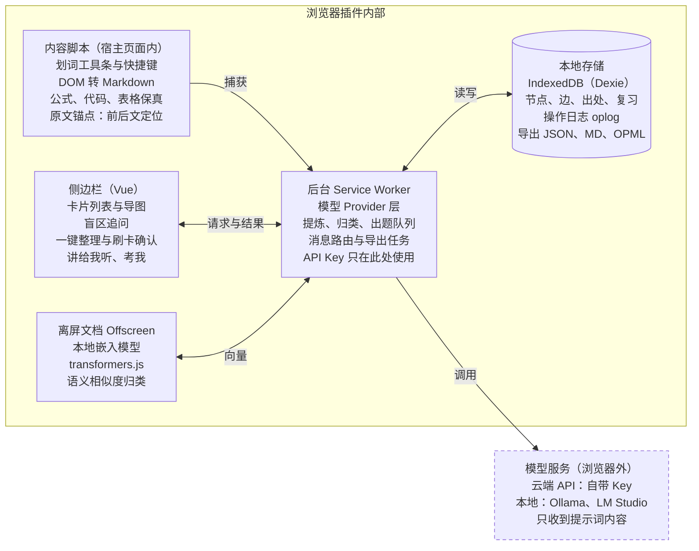

# Chat2Know：浏览器插件项目方案

2026-10-20 · Shaowen Fu

## 北极星目标

**让每一次与 AI 的对话，都沉淀成你离开对话后仍能讲得出来的知识。**

这个项目不是更好的聊天界面，而是叠在所有 AI 客户端之上的"知识层"：负责捕获、蒸馏、组织和检验。

**北极星指标：每周"已掌握卡片"数。** 只统计经过"讲给我听"或"考我"检验并通过的卡片，不统计保存了多少。保存只是收藏，能讲出来才算掌握。

**个人验收测试（论文测试）：** 读完一篇论文，24 小时后只看图谱，在 3 分钟内讲清它的问题、方法、结果和局限。每个里程碑都拿真实论文跑一遍这个测试。

| 护栏指标 | 目标 | 为什么重要 |
| --- | --- | --- |
| 捕获操作数 | 选中后 1 次点击或 1 个快捷键 | 打断阅读就没人用 |
| 原文入库耗时 | 小于 1 秒，AI 提炼异步进行 | 捕获不能等模型 |
| 精华压缩比 | 卡片约为原文的 10–20% | 精华才值得复习 |
| 宿主对话污染 | 0：盲区追问不写入原对话 | 主线上下文保持干净 |
| 出处回溯成功率 | 95% 以上能跳回原文位置 | 只看精华也能放心 |
| 数据可带走 | 任何时候 100% 可导出 | 用户信任的底线 |

开源本地版不做任何遥测。这些指标显示在本地统计面板里，只给用户自己看。

## 问题与核心洞察

直接在网页里问 AI，会同时遇到三个问题。前两个是工具问题，第三个是学习问题，也是本项目的真正切入点。

1. **对话是线性的，知识是树状的。** 每个回答里都可能有知识盲区。在线性对话里追问，主线被冲走，上下文越来越长，AI 开始偏离重点。
2. **信息没有被蒸馏。** 回答里大部分内容与语气、铺垫、上下文衔接有关，真正值得记住的只占一小部分。精简全靠手动整理，所以基本不会发生。重要的见解、灵感、启发都散落在对话里。
3. **读懂的错觉。** 读 AI 的流畅解释时感觉全懂了，离开对话却说不清楚，脑子里没有基本语料。原因不是没记笔记，而是从来没被要求自己说出来。回头重读整段对话，效率又太低。

**核心洞察：** 只解决前两个，得到的是一个更好的笔记工具。把"检验与复述"也做进来，才是"教师"。竞品大多停在整理层，检验层是差异化所在。

## 产品原则

出现取舍时，按下面的顺序判断。

1. **不做对话界面，做知识层。** 以浏览器插件形态存在，在任何 AI 客户端上都能用。
2. **捕获即时，整理延后，确认批量。** 阅读时只需一个动作；归类和提炼由 AI 提议，用户事后一次确认。
3. **不做站点适配。** 只抓文本，结构交给模型还原。网站改版不应该让核心功能失效。
4. **本地优先，数据属于用户。** 免登录，自带 API Key，数据存在本地，任何时候都能完整导出。
5. **精华与原文双层。** 精华卡片用来读和复习，原文用来回溯和印证。
6. **检验高于收藏。** 衡量价值的是能讲出来多少，而不是存了多少。
7. **AI 提议结构，人决定结构。** 图谱的形状由用户掌控，避免越用越乱。

## 核心功能与交互设计

交互的重点只有一个：把对话里的内容丝滑地沉淀进跨会话的知识图谱。功能按"主动程度"从高到低排列。

### 1. 划词捕获（通用基础层）

在任意网页选中文字，旁边浮出小工具条，也可以用快捷键：

- **存知识**：原文立即入库；AI 异步压成 1–3 句精华卡片，并推荐挂到图谱的哪个节点下。回车接受，或拖到别处。
- **存灵感**：原样保存，标为灵感类型，不压缩。
- **盲区**：在侧栏里追问，详见第 3 条。

这一层不依赖网站结构，所以在 AI 对话页、普通网页、在线 PDF、论文页面上都能用。

### 2. 侧栏实时子树

侧边栏常驻右侧，显示当前对话正在长出来的那棵子树。可以把一段回答直接拖到某个节点下。用户随时看得到自己在知识树的什么位置，不容易跑偏。

### 3. 盲区追问（不污染主对话）

点"盲区"后，插件用自己的模型调用，在侧栏里给出简短解释。解释直接成为图谱里的子节点。宿主对话完全不受影响：上下文不变长，主线不跑偏。这就是"分支式提问"，只是分支长在你自己的图谱里。

### 4. 一键整理

两种入口：

- **整页整理**：抽取当前页面主体文本，由模型切分问答轮次并生成候选卡片。
- **粘贴整理**：用宿主网站的"复制"按钮复制回答，粘贴到侧栏。这是抓取失败时的兜底方案，保真度也最高。

候选卡片逐张处理：保留、修改或丢弃。几十秒就能过完一整段对话，不用从头重读。

### 5. 图谱回流

提问时，一键把相关卡片作为背景注入宿主网站的输入框，例如"我已经知道 A、B，不清楚 C"。AI 不再重复讲你已经懂的内容，回答更短更准。

### 6. 教师模式

- **讲给我听**：对着某棵子树，用打字或语音复述。AI 指出漏掉和讲错的地方，并在图谱上标红。
- **考我**：根据精华卡片出题，按间隔重复安排复习时间。
- **一分钟讲清楚**：为一棵子树生成一份可以直接说出口的复述稿。

### 7. 出处回溯

每张卡片记录来源 URL 和原文片段，点一下就能跳回原文位置。

### 节点类型

| 类型 | 内容 | 是否压缩 | 是否进入"考我" |
| --- | --- | --- | --- |
| 知识 | 概念、结论、方法 | 是 | 是 |
| 见解 | 自己的理解和判断 | 否 | 可选 |
| 灵感 | 想法、启发、待验证的点子 | 否 | 否 |
| 疑问 | 还没弄懂的问题 | 否 | 否，解决后转为知识 |

## 技术架构

第一阶段的架构是本地优先加自带 Key：所有数据存在浏览器里，唯一离开浏览器的是发给你所配置模型服务的提示词。



*数据只存在本地，只有模型调用离开浏览器。虚线框在浏览器之外；其余部分都运行在插件内部。*

内容脚本只负责捕获，侧栏只负责界面，所有模型调用和数据读写都经过后台，API Key 只在后台使用。

**技术栈：** WXT（跨浏览器插件框架）+ Vue 3 + TypeScript；Dexie（IndexedDB）；Turndown（HTML 转 Markdown）；transformers.js（本地嵌入）；Vitest + Playwright（测试）。

### 通用捕获方案（不做站点适配）

- **选区转 Markdown：** 在 Turndown 上加自定义规则。KaTeX/MathJax 公式从页面保留的 `annotation[encoding="application/x-tex"]` 中取回 LaTeX；代码块保留语言；表格转成 Markdown 表格。
- **消息边界：** 从选区向上查找祖先节点，若其父节点下有多个结构相似的兄弟节点，就把它视为"一条消息"。
- **整页整理：** 抽取页面主体文本，交给模型切分问答轮次。不靠选择器判断哪句是用户说的、哪句是 AI 说的。
- **出处锚点：** 存 URL、原文片段及其前后文，沿用 W3C Web Annotation 的 TextQuoteSelector 思路；跳回时用 Text Fragment（`#:~:text=`）定位。
- **兜底：** 粘贴整理，覆盖所有抓取失败的情况。

### 模型层接口

所有服务商实现同一个接口。大多数服务商兼容 OpenAI 格式，Anthropic 和 Gemini 各写一个转换层。

```ts
interface LLMProvider {
  id: string;
  kind: 'openai-compatible' | 'anthropic' | 'gemini' | 'ollama';
  chat(req: ChatRequest, signal?: AbortSignal): AsyncIterable<ChatChunk>;
  testConnection(): Promise<{ ok: boolean; message?: string }>;
}

interface EmbeddingProvider {
  model: string;
  embed(texts: string[]): Promise<Float32Array[]>;
}
```

### 权限

- 必需：`sidePanel`、`storage`、`activeTab`、`scripting`、`contextMenus`。
- 模型服务的地址作为可选主机权限，用户添加 Provider 时再申请。
- 不申请"读取所有网站"权限。内容脚本在用户触发时按需注入。

## 数据模型

图谱由"节点 + 边"组成：每个节点有一个主父节点，构成导图的树形视图；再加上任意数量的关联边，构成跨会话的图谱。数据从第一天起就按可同步的方式设计，以后加同步不需要迁移。

| 表 | 关键字段 | 用途 |
| --- | --- | --- |
| `nodes` | `id`、`type`、`title`、`summary`（精华）、`body`（原文 Markdown）、`status`、`createdAt`、`updatedAt`、`deletedAt` | 所有知识、见解、灵感、疑问和主题节点 |
| `edges` | `id`、`from`、`to`、`kind`（child / related / derived）、`order` | 父子关系、关联关系、由哪条原文派生 |
| `sources` | `id`、`nodeId`、`url`、`pageTitle`、`quoteExact`、`quotePrefix`、`quoteSuffix`、`capturedAt` | 出处与回溯锚点 |
| `reviews` | `id`、`nodeId`、`mode`（recall / explain）、`prompt`、`answer`、`verdict`、`feedback`、`dueAt`、间隔重复状态 | "考我"与"讲给我听"的记录，也是北极星指标的数据来源 |
| `embeddings` | `nodeId`、`model`、`dim`、`vector` | 语义归类与概念合并 |
| `oplog` | `id`（混合逻辑时钟）、`entity`、`entityId`、`op`、`patch` | 所有修改的操作日志，为将来的同步预留 |

```ts
type NodeType = 'topic' | 'knowledge' | 'insight' | 'idea' | 'question';
type NodeStatus = 'draft' | 'confirmed' | 'mastered';

interface KNode {
  id: string;          // ULID，按时间可排序
  type: NodeType;
  title: string;
  summary?: string;    // 1–3 句精华，由 AI 起草、用户确认
  body?: string;       // 原文 Markdown，保留公式、代码、表格
  status: NodeStatus;  // mastered 只能由通过的检验设置
  createdAt: number;
  updatedAt: string;   // 混合逻辑时钟，用于将来的冲突合并
  deletedAt?: number;  // 软删除
}
```

- **所有写操作都通过一个仓储层完成**，同时写业务表和 `oplog`。UI 和后台都不直接操作 IndexedDB。
- **兄弟节点排序用分数索引**（fractional index），拖动排序只改一个节点的 `order`。
- **概念合并**：新节点与已有节点的嵌入相似度超过阈值时，提示"是否与某节点合并"，由用户确认。
- **设置和 API Key** 存在 `chrome.storage.local`，不进入 IndexedDB，导出时默认排除。

## 里程碑与验收标准

每个里程碑都要能独立使用，验收标准写成可以自动测试的形式，交给 Claude Code 按标准实现和自测。M1 不接 AI 也已经是一个有用的工具。

| 里程碑 | 交付内容 | 验收标准 |
| --- | --- | --- |
| M0 骨架跑通 | WXT + Vue 3 + TypeScript 项目；点击图标打开侧栏；内容脚本、后台、侧栏三方通信；测试与 lint 脚本 | E2E 测试能加载插件并打开侧栏；三方消息往返测试通过；`npm run check` 一条命令跑完全部检查 |
| M1 无 AI 捕获 | 划词工具条与快捷键；DOM 转 Markdown；IndexedDB 存储；侧栏卡片列表；出处回溯；JSON 与 Markdown 导出，JSON 导入 | 在全部页面快照样本上，公式还原为 LaTeX、代码块保留语言、表格保留结构；JSON 导出再导入无损；点击卡片能跳回原文并高亮 |
| M2 接入模型 | 设置页：多个 Provider、测试连接；异步提炼精华；确认流程；失败重试 | 用本地模拟服务器测完整提炼流程；Key 不出现在日志和导出里；Key 错误或断网时原文照常入库 |
| M3 导图与盲区追问 | 侧栏导图视图；拖拽挂载；盲区追问生成子节点 | 追问前后宿主页面 DOM 无任何改动；子节点挂在正确的父节点下；拖拽后排序持久化 |
| M4 语义归类与一键整理 | 本地嵌入模型；挂载推荐；概念合并提示；整页整理与粘贴整理；刷卡确认 | 建立固定的评测样本集，记录挂载推荐的 Top-3 命中率作为后续优化基线；整页整理在全部快照样本上都能切分出问答轮次 |
| M5 教师模式 | 讲给我听；考我；间隔重复；本地统计面板；Markdown、OPML、Anki CSV 导出 | 统计面板正确显示北极星指标；用一篇真实论文完整跑通"论文测试" |
| M6 开源发布 | README、贡献指南、许可证、隐私说明；Chrome 与 Firefox 打包 | 新用户按 README 能在 10 分钟内装好并完成第一次捕获 |

## Claude Code 开发与测试闭环

目标：Claude Code 在 WSL 里独立完成"写代码、跑测试、读失败、修复"的循环，不需要你手动打开 Chrome。你只在每个里程碑结束时做一次手感测试和论文测试。

### 让闭环成立的四个前提

1. **仓库根目录有 `CLAUDE.md`。** 写明北极星目标、产品原则、架构约束、常用命令和"完成的定义"。Claude Code 每次启动都会读它。
2. **一条命令跑完全部检查。** `npm run check` 依次执行类型检查、lint、单元测试、构建和 E2E 测试。完成的定义就是这条命令全绿。
3. **测试不依赖真实模型。** 写一个本地模拟服务器，实现 OpenAI 兼容接口并返回固定结果。测试不需要 API Key，也不花钱。真实模型的测试单独放一组，通过环境变量手动开启。
4. **页面快照样本库。** 把 ChatGPT、Claude、Gemini、DeepSeek、Kimi 的对话页面，以及 arXiv 论文页和普通博客，各存一份 HTML 到 `tests/fixtures/pages/`。每份配一个期望的 Markdown 输出。"通用抓取到底有多通用"由这个样本库来回答。

### 测试分层

| 层 | 工具 | 测什么 |
| --- | --- | --- |
| 单元测试 | Vitest + fake-indexeddb | DOM 转 Markdown、公式提取、锚点、仓储层、导出导入往返、提示词构造 |
| 快照测试 | Vitest + happy-dom | 在每个页面样本上跑抓取，与期望输出逐字对比 |
| E2E 测试 | Playwright + Chromium 加载插件 | 在本地静态服务器上打开样本页，模拟划词、点击工具条，检查侧栏和数据库 |
| 截图自检 | Playwright 截图 | 侧栏界面截图，Claude Code 读图检查布局有没有明显问题 |
| 手感测试 | 你本人 | 每个里程碑结束时在 Windows 的 Chrome 里实际使用 |

Playwright 自带的 Chromium 支持加载插件，可以在 WSL 里以无界面方式运行。具体启动参数以 Playwright 当前文档为准。

### 每个功能的工作循环

1. 读该里程碑的验收标准，拆成任务。
2. 先写或更新测试，让测试表达验收标准。
3. 实现功能。
4. 运行 `npm run check`，读失败输出并修复，直到全绿。
5. 涉及界面时，截图自检。
6. 小步提交，提交信息说明改了什么、为什么。
7. 更新 `CHANGELOG.md` 和相关文档。

### 目录结构

```text
entrypoints/
  content/          # 划词工具条、捕获
  background.ts     # Provider 层、任务队列、消息路由
  sidepanel/        # Vue 侧栏应用
  offscreen/        # 本地嵌入模型
src/
  capture/          # DOM 转 Markdown、公式提取、消息边界、锚点
  db/               # Dexie 表结构、仓储层、oplog
  llm/              # Provider 接口与实现、提示词
  graph/            # 树与图的操作、归类、合并
  export/           # JSON / Markdown / OPML / Anki
  messaging/        # 类型安全的消息协议
tests/
  unit/
  fixtures/pages/   # 各家对话页面的 HTML 快照
  fixtures/expected/
  e2e/
  mock-llm/         # 本地模拟模型服务器
CLAUDE.md
```

### WSL 注意事项

- 在 WXT 配置里关闭开发模式自动启动浏览器，WSL 里打不开 Windows 的 Chrome。
- 在 WSL 里安装 Playwright 的 Chromium 及其系统依赖。
- 手感测试时，Windows 的 Chrome 从 `\\wsl.localhost\Ubuntu\...` 路径加载 `.output/chrome-mv3`。
- 真实 API Key 只放在 `.env.local`，并加入 `.gitignore`。

## 开源策略与后续路线

路线分三步：先把工具做好，再考虑做服务，最后考虑商业化。当前阶段只做第一步，但架构上为后两步留好接口。

1. **开源工具（当前）。** 免登录，自带 API Key，数据只存本地，完整导出，不做遥测。
2. **服务（以后）。** 自托管同步（WebDAV、S3 等），跨设备同步，手机端 Web/PWA 复习。
3. **商业化（再以后）。** 官方云模型订阅，实时同步。导出永远免费。

**许可证需要现在就定**，因为它决定了以后做官方服务时别人能怎么用你的代码：

- **MIT 或 Apache-2.0**：最宽松，社区接受度高。代价是别人可以拿去做闭源的商业服务。
- **AGPL-3.0**：别人拿去提供网络服务，也必须公开源码。适合"开源工具 + 官方云服务"的模式。

正式决定前，建议再仔细查一下各个许可证的条款。

**开源要守住的底线：**

- API Key 只存在 `chrome.storage.local`，不进日志，不进仓库，导出默认排除。
- 权限最小化：使用 `activeTab` 和按需注入脚本，不申请"读取所有网站"。
- README 里写清楚：哪些数据存在本地，哪些内容会发送给你配置的模型服务商。

## 风险与待定问题

| 风险 | 影响 | 应对 |
| --- | --- | --- |
| 通用抓取在某些站点失效 | 整页整理切分出错 | 划词和粘贴整理始终可用；快照样本库持续扩充，失效就加样本 |
| 导图越用越乱 | 用户放弃使用 | AI 只提议结构，人确认；提供合并、移动、归档操作 |
| 提炼质量不稳定 | 精华卡片不可信 | 卡片始终可以跳回原文；提示词版本化，用评测样本对比效果 |
| 自带 Key 门槛高 | 非技术用户流失 | 设置页提供连接测试和常见服务商的预设；支持本地 Ollama |
| 后台脚本被浏览器休眠 | 长任务中断 | 任务队列持久化到 IndexedDB，唤醒后续跑 |

**待定问题：**

- [ ] 项目名称：已定为 Chat2Know（仓库名 chat2know，标语"聊过的，都能讲出来"）
- [ ] 许可证：Apache-2.0 还是 AGPL-3.0
- [ ] 导图渲染库：Vue Flow、Cytoscape.js 等，需要做一次小型对比
- [ ] 本地嵌入模型选哪个，需要支持中英文混合
- [ ] 竞品调研：已有的对话分支、自动导图类工具分别做到了哪一步
- [ ] "讲给我听"是否在 M5 就支持语音输入
